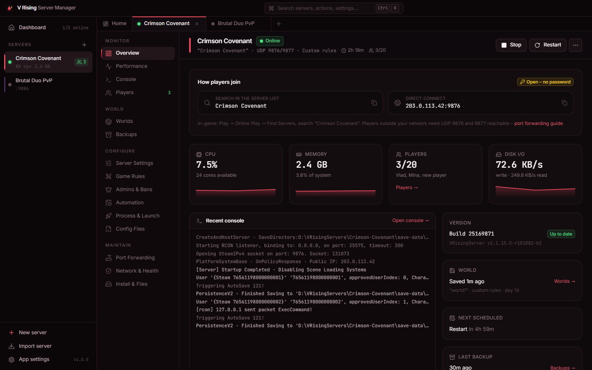
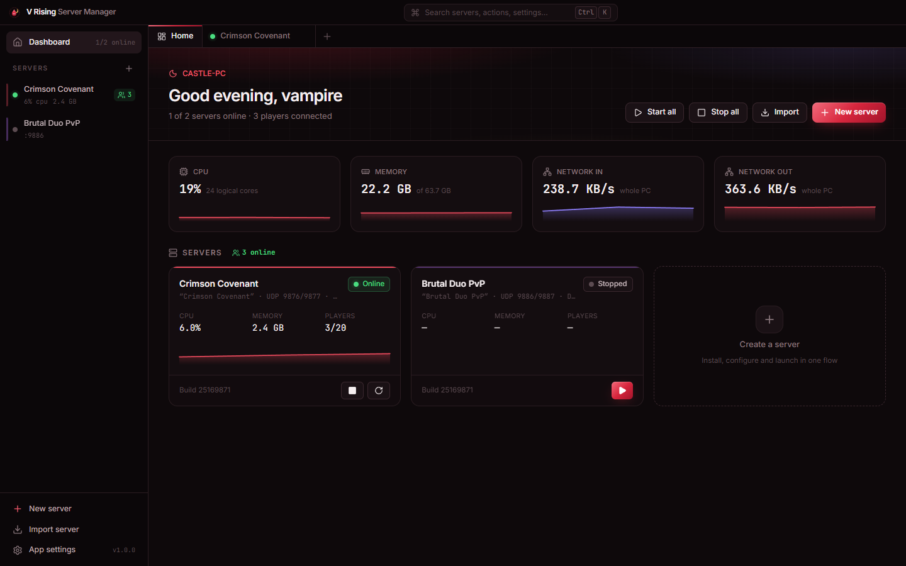
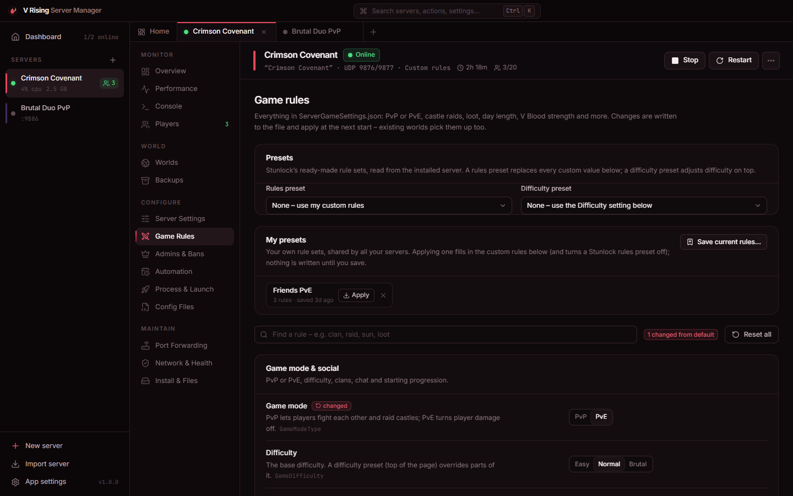
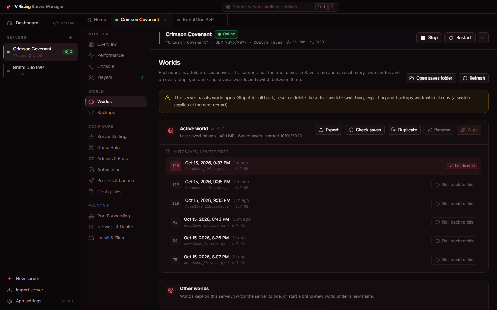
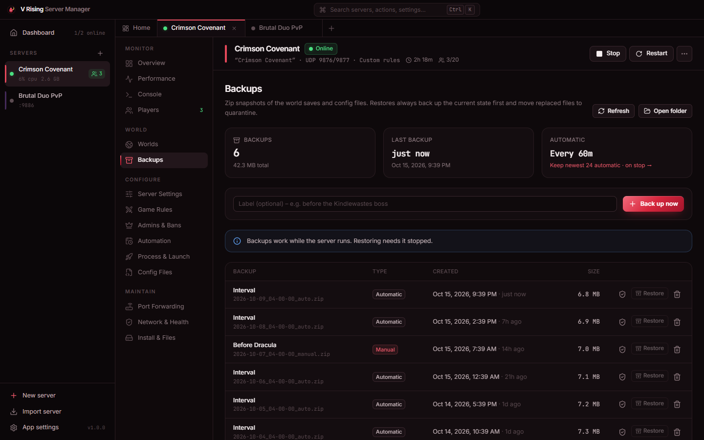
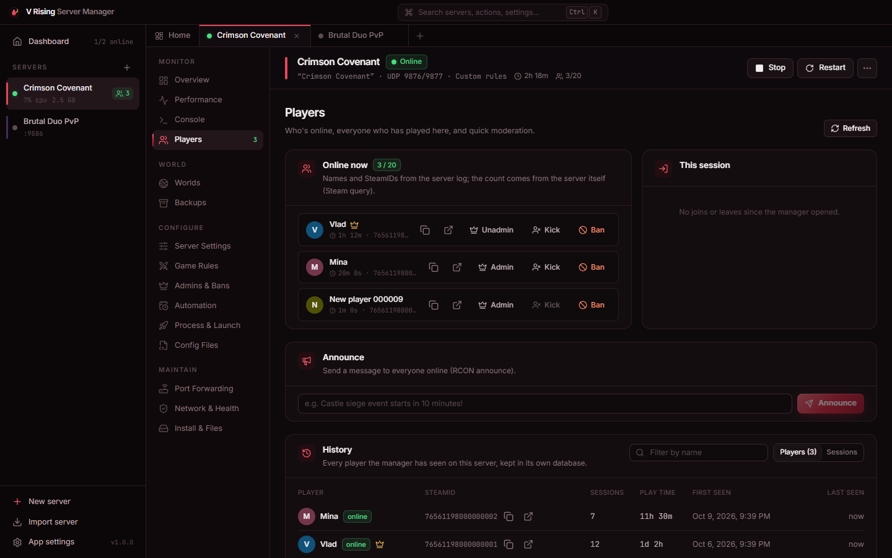
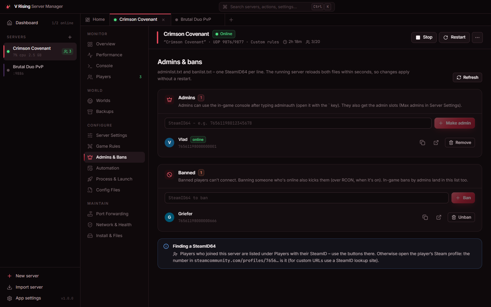
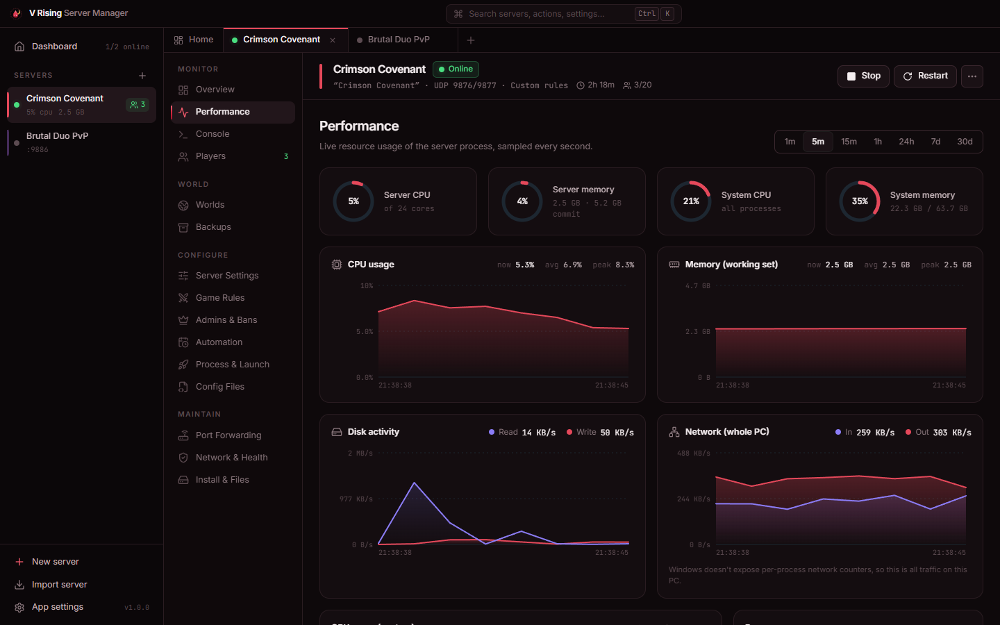
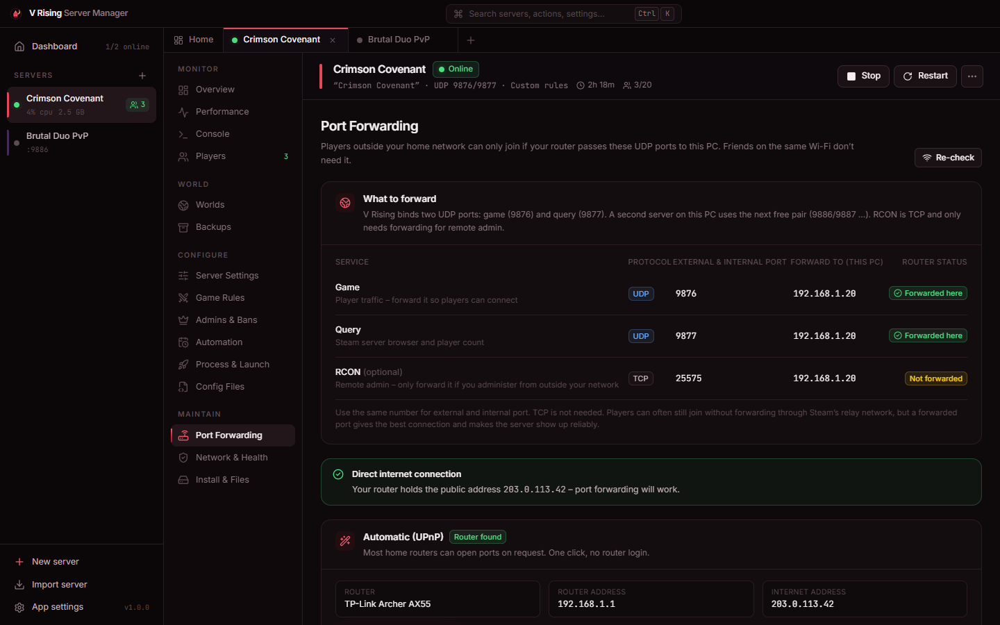

<div align="center">


# V Rising Server Manager

### Host your own V Rising dedicated server on Windows – no batch files, no JSON, no guesswork.

Install, configure, monitor, back up and automate any number of servers from one fast desktop app.

[](https://github.com/clawdroppin/VRising_ServerManager/releases/latest)
[](https://github.com/clawdroppin/VRising_ServerManager/releases)
[](https://github.com/clawdroppin/VRising_ServerManager/actions/workflows/ci.yml)

[](LICENSE)

**[⬇ Download the installer](https://github.com/clawdroppin/VRising_ServerManager/releases/latest/download/VRising-Server-Manager-Setup.exe)** &nbsp;·&nbsp; [Portable zip](https://github.com/clawdroppin/VRising_ServerManager/releases/latest/download/VRising-Server-Manager-Portable.zip) &nbsp;·&nbsp; [User guide](docs/USER_GUIDE.md) &nbsp;·&nbsp; [For AI agents](#-for-ai-agents--contributors) &nbsp;·&nbsp; [Changelog](CHANGELOG.md)

<br />



</div>

<br />

## 🩸 Why this exists

Running a V Rising server by hand means SteamCMD commands, a batch file with the right `-persistentDataPath`, two JSON files with ~200 settings (where a preset silently overrides all of your rules), SteamIDs typed into text files, no warning for players before a restart, no idea who's online, and a firewall prompt that quietly blocks everyone.

**V Rising Server Manager does all of that for you** – and it's been tested against the real dedicated server (Steam app `1829350`, build 25169871, v1.1.15.0).

<br />

## ✨ What it does

<table>
<tr>
<td width="50%" valign="top">

### 🚀 One-click servers
A four-step wizard picks free ports (UDP **9876/9877**, then 9886/9887 …), sets PvE or PvP, difficulty, password and your admin SteamID, turns on RCON with a strong password and downloads the server with SteamCMD – no Steam login needed.

</td>
<td width="50%" valign="top">

### 📜 Game rules in plain language
Every ServerGameSettings key – clans, raid and siege windows, castle limits per heart level, loot, sun damage, day length, V Blood strength – plus Stunlock's presets, *copy preset into custom rules* and **your own presets** shared across servers.

</td>
</tr>
<tr>
<td valign="top">

### 👑 Admins, bans & RCON
adminlist / banlist with names from player history, applied live. Announcements, timed messages, “restarting in 5 minutes” countdowns before every automatic restart (cancellable), kicks and an RCON console. Name, description and password change **live – no restart**.

</td>
<td valign="top">

### 🧛 Real player tracking
Names and SteamIDs from the server log, the live count from the server itself (Steam query), the in-game day, a join/leave feed, Steam profile links and a player history with play time.

</td>
</tr>
<tr>
<td valign="top">

### 🌍 Worlds you can't lose
Several worlds per server – switch, start new, duplicate, rename, wipe. Autosave rollback that never overwrites, **Check saves** that finds damaged autosaves before the server loads them, and import of private games from this PC.

</td>
<td valign="top">

### 🛡️ Backups that restore
Every world's newest autosave plus the settings – on an interval, on stop and before updates – with retention, **one-click verify**, safe restore (quarantine first) and portable `.vrising` server packs.

</td>
</tr>
<tr>
<td valign="top">

### ⚙️ Proper lifecycle
Start, stop, restart, force stop. Stops save the world first. Servers keep running when the manager closes and are re-adopted on launch. Crash auto-restart with a loop guard.

</td>
<td valign="top">

### 📈 Performance & automation
Live CPU, memory, disk, network and per-core charts with 24 h / 7 d / 30 d history. Schedules, auto-update, wait-for-empty, stop when empty, memory/uptime limits, start with Windows, tray mode, toasts and Discord/Slack webhooks.

</td>
</tr>
<tr>
<td valign="top">

### 🌐 Network & health
Port-forwarding guide with one-click UPnP, router detection, double-NAT/CGNAT warnings, firewall fixes (including Windows' silent Block rules), “Is it listed on Steam?”, an A2S query tool and health checks with fix buttons.

</td>
<td valign="top">

### 🔒 Safe & private
Lossless editing of both JSON files and both lists with validation and 30 versions of history; unknown keys are never touched. Passwords and webhooks encrypted at rest (DPAPI). Streamer mode hides IPs, passwords and SteamIDs.

</td>
</tr>
</table>

<br />

<div align="center">
 
 
 
 
</div>

<br />

## 🎮 For server hosts

### Quick start

1. **Download** [`VRising-Server-Manager-Setup.exe`](https://github.com/clawdroppin/VRising_ServerManager/releases/latest/download/VRising-Server-Manager-Setup.exe) and run it.
   SmartScreen may warn because the app isn't code-signed yet: **More info → Run anyway**.
2. Click **New server**, give it a name, pick **PvE or PvP** and add your **SteamID64** as admin.
3. Wait for the download (about 300 MB, 2 GB on disk), then press **Start** – it's online in about 30 seconds.
4. Open **Port Forwarding**: *Forward ports automatically* (UPnP) or follow the router steps, and *Allow through firewall*.
5. Friends open **Online Play → Find Servers** and search your server name. The Overview has copy buttons for the name, address and password.

Already running a server? **Import server → Existing folder** adopts it with its worlds and settings. Servers installed through the Steam client are found automatically.

📖 **The full walkthrough – settings, game rules, worlds, backups, automation and troubleshooting – is in the [User guide](docs/USER_GUIDE.md).**

### What you need

| | |
|---|---|
| **OS** | Windows 10 or 11 (64-bit) |
| **RAM** | ~3 GB for a quiet world, 8 GB+ for a busy 40-player server |
| **Disk** | ~2 GB per server + ~7 MB per autosave + backups |
| **Network** | Forward **UDP 9876 + 9877** (or use UPnP) for players outside your home |

### Ports

| Port | Protocol | What it's for |
|---|---|---|
| **9876** | UDP | Game traffic – forward it |
| **9877** | UDP | Steam query (server browser) – forward it |
| 25575 | TCP | RCON – used by the manager on this PC; forward only for remote admin |
| 9090 | TCP | HTTP API (off by default) |

A second server uses 9886/9887 (RCON 25576), and so on – the manager picks free ports for you.

### FAQ

<details><summary><b>Nobody can find my server</b></summary>

Check that *List on Steam* is on (Server Settings), then open **Network & Health** – the *Steam server list* check asks Steam whether your server is listed. If it isn't, allow the firewall and forward UDP 9876 and 9877 under **Port Forwarding**. After a game patch, update the server: players can only join servers on their version.
</details>

<details><summary><b>How do I make someone an admin?</b></summary>

Add their SteamID64 under **Admins & Bans** (or click *Admin* next to them on the Players page). It applies within seconds; they then type `adminauth` in the in-game console.
</details>

<details><summary><b>Why are my custom rules ignored?</b></summary>

A rules preset is selected under **Game Rules**. While one is set, the server ignores ServerGameSettings.json completely. Clear it, or use *Copy into custom rules* to start from the preset.
</details>

<details><summary><b>The server stops right after starting</b></summary>

Look at the **Console** for `Exiting!`, `Error parsing` or `Address already in use`; **Network & Health** explains settings problems. **Worlds → Check saves** finds a damaged newest autosave – roll back to the newest intact one.
</details>

<details><summary><b>Can I move my private game to the server?</b></summary>

Yes – **Worlds → Bring a world from the game** lists private games found on this PC, or pick any folder with `AutoSave_N` files. It's copied (optionally with its game rules); your own save stays untouched.
</details>

<details><summary><b>Do I have to keep the manager open?</b></summary>

Servers keep running without it. Crash recovery, schedules, restart warnings, announcements, backups, update checks and player history need the manager, so it can sit in the tray and start with Windows.
</details>

<details><summary><b>Does it support Linux servers or mods?</b></summary>

Not yet – the manager runs and controls Windows servers, without BepInEx mods. Both are on the [ideas list](AGENTS.md#6-ideas--not-yet-done).
</details>

<br />

## 🤖 For AI agents & contributors

This repository is set up to be picked up by an AI coding agent (Claude Code, Codex, Copilot …) or a human contributor without any other context.

> [!IMPORTANT]
> **Read [`AGENTS.md`](AGENTS.md) before changing anything.** It holds the architecture, every verified fact about the V Rising server (log lines, ports, RCON behaviour, save layout), the invariants that keep users' worlds safe, and step-by-step recipes. [`CLAUDE.md`](CLAUDE.md) points there too.

### The rules that matter most

| ❗ | Rule |
|---|---|
| 1 | The server is configured **only** through `<data>\Settings\*.json` – read-modify-write the keys the profile owns, never whole files (unknown keys must survive). |
| 2 | **Never keep an RCON connection open** – it stops the server from exiting after its save. One connection per command. |
| 3 | Single RCON arguments must be **quoted** (`name "My Server"`); the server reports errors as replies starting with `error:`. |
| 4 | **Never lose user data** – rollbacks, wipes, restores and deletes quarantine first and take a safety backup. |
| 5 | A new command goes into `commands.rs` → `lib.rs` → `src/lib/ipc.ts` → `src/lib/devMock.ts`. |
| 6 | Hand off green: `cargo check` (no warnings), `cargo test --lib`, `npx tsc -p tsconfig.json --noEmit`; update the [User guide](docs/USER_GUIDE.md) and [Changelog](CHANGELOG.md) when behaviour changes. |

### Build & run

Requirements: Node 22+, Rust (stable, MSVC) and the WebView2 runtime (part of Windows 10/11).

```bash
npm install
npm run tauri dev                   # full app with hot reload
npm run dev                         # UI only, in a browser, with a mock backend
cd src-tauri && cargo test --lib    # backend unit tests
npm run build:all                   # NSIS + MSI installers and a portable zip
```

Testing against a real server: build with `npx tauri build --debug --no-bundle`, run it with `VRSM_CDP_PORT=9444` and drive the WebView over the Chrome DevTools Protocol – details in [AGENTS.md § 1](AGENTS.md#1-stack--commands).

### Project map

```
src-tauri/src/
  commands.rs      every Tauri command (thin wrappers)
  core/            config · server lifecycle · supervisor loop · rcon · a2s · worlds · backup
                   presets · history (SQLite) · secrets (DPAPI) · steamcmd · network · upnp · diagnostics
src/
  features/server/ the server workspace and its pages (Overview, Game Rules, Worlds, Backups …)
  lib/             typed IPC, mock backend, live buffers, formatting
  data/gameplay.ts every ServerGameSettings key with labels, defaults and groups
docs/              user guide, screenshots, icon
```

**Stack:** Tauri 2 · Rust (tokio, reqwest, rusqlite, zip) · React 19 · TypeScript 7 · Vite 8 · Tailwind CSS 4 · Zustand · CodeMirror 6.

### Releasing

The default branch is **`release`**. Bump the version in `package.json`, `src-tauri/Cargo.toml` and `src-tauri/tauri.conf.json`, add a changelog entry, then push a tag (`git tag v1.2.0 && git push origin release --tags`). The release workflow builds and publishes the installer, MSI, portable zip and checksums.

<br />

---

<div align="center">
<sub>Not affiliated with or endorsed by Stunlock Studios. V Rising is a trademark of Stunlock Studios AB. MIT licensed.</sub>
</div>
